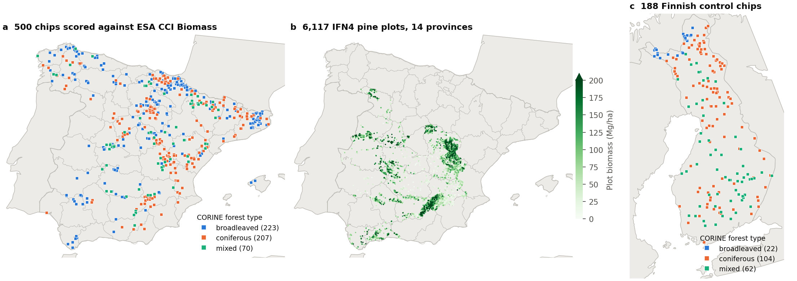
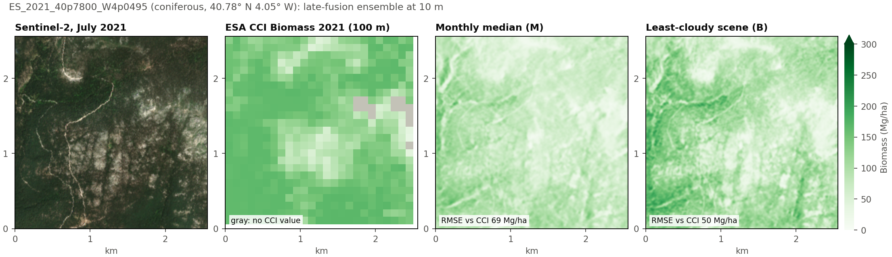

# Deploying Sentinel-1/2 biomass models in Spain

**What does it take to use a biomass model trained in Finland somewhere else?** This repository holds the code, saved predictions and Earth Engine downloader behind a study of ten Sentinel-1/2 biomass models trained on the Finnish [BioMassters](https://huggingface.co/datasets/nascetti-a/BioMassters) benchmark and applied in Spain. It asks two practical questions:

1. **How should the imagery be prepared?** The same chips are scored against ESA CCI Biomass with two Sentinel-2 recipes: monthly medians, and the least-cloudy scene per month used in training.
2. **Is it worth adapting the model with local field plots?** The models are compared with Spanish National Forest Inventory (IFN4) plots, before and after fine-tuning, and with networks trained without BioMassters weights.

This repository accompanies the manuscript *Deploying Sentinel-1/2 Biomass Models in Spain: Preprocessing Sensitivity and Inventory-Based Adaptation*, by Alberto Albiol, Miquel Obrador-Reina, Juan B. Pedro, and Albert Fernández.

**Publication status:** the manuscript is under review. It will be linked here, or its arXiv version, after acceptance.

| | Where |
|---|---|
| Code, documentation, reference results | this GitHub repository |
| **Data** (5 GB): 10-m prediction maps, CCI grids, plot table with coordinates, predictions of every run, adapted weights | **[EOTDL dataset `spain-biomass-transfer-igarss`](https://www.eotdl.com/datasets/spain-biomass-transfer-igarss)**, which also contains this repository |
| The ten models, with inference code and example patches | [sentinel-biomass-inference](https://github.com/alalbiol/sentinel-biomass-inference) ([EOTDL model](https://www.eotdl.com/models/sentinel-biomass-inference)) |

## The study at a glance



**a.** 500 Spanish forest chips (2.56 × 2.56 km, 2021), stratified by CORINE forest type and CCI biomass level. Every model is run on each chip with both Sentinel-2 recipes, and its predictions are scored against ESA CCI Biomass on 100-m blocks. **b.** 6,117 IFN4 plots dominated by five pine species in 14 provinces, used to adapt the early-fusion EfficientNet model and to evaluate it in provinces held out from training. **c.** 188 Finnish chips scored the same way against CCI, as a control.



On this conifer chip in the Sierra de Guadarrama, switching to the training recipe (least-cloudy scene) raises the late-fusion ensemble's predictions towards CCI. Across all 499 scored chips:

| Experiment | Main result |
|---|---|
| Sentinel-2 recipe, M → B | Late-fusion ensemble R² vs CCI 0.232 → 0.324; early fusion 0.344 → 0.311 |
| Finnish control | Negative CCI bias in both countries (−13.7 Finland, −16.6 Spain, Mg/ha, recipe M) |
| Inventory adaptation | Fine-tuning from BioMassters weights: RMSE 40.15 Mg/ha (three seeds), against 45.65 unadapted and 44.32 / 44.17 from random / ImageNet weights |
| Few local plots | With 10% of the fitting plots, BioMassters weights are 5–11 Mg/ha better than both controls |

## Reproduce the reported numbers (about a minute, CPU)

Download the snapshot with the [EOTDL client](https://www.eotdl.com/docs/getting-started/install) (Python 3.12+, kept in its own environment). The snapshot already contains this code:

```bash
eotdl auth login
eotdl datasets get spain-biomass-transfer-igarss --path ./downloads
```

Then, with Python 3.11, inside the downloaded folder (the one containing `release-manifest.json`):

```bash
python3.11 -m venv .venv && source .venv/bin/activate
python -m pip install -r requirements.txt
python scripts/reproduce.py                 # every table and number except Table I, checked against expected/
python scripts/check_prediction_maps.py     # optional: the 10-m maps pool exactly to the scored 100-m blocks
```

To use a Git checkout instead, set `DATA_DIR` to the snapshot's `data/` folder. [REPRODUCING.md](REPRODUCING.md) maps every table and number of the manuscript to its output field, and explains why Table I (native 10 m, 122 GB of BioMassters inputs and a GPU) is not recomputed.

## Get the imagery from Google Earth Engine

The Sentinel-1/2 inputs are public in Earth Engine, so they are not redistributed. `scripts/download_gee.py` downloads them again with the study's recipes, on the original grids, and for recipe B with the same scenes:

```bash
python -m pip install -r requirements-gee.txt
earthengine authenticate
export EE_PROJECT=<your-cloud-project-id>
python scripts/download_gee.py chips --dataset spain --recipe best --chips ES_2021_40p7800_W4p0495 --out-dir downloads/spain_best
python scripts/download_gee.py ifn --limit 10 --out-dir downloads/ifn
```

The downloaded chips can go straight into the models of sentinel-biomass-inference. [GEE.md](GEE.md) covers setup, the three recipes, file formats, run times, and how close a new download is to the original inputs.

## Contents

| Path | Contents | Where |
|---|---|---|
| `analysis/` | The six analyses: CCI block scoring, recipe comparison and bootstraps, Finnish 100-m benchmark, IFN adaptation, pretraining and seeds, no-pretraining baselines | GitHub + EOTDL |
| `expected/` | Reference outputs, including the Table I results that need GPU inference | GitHub + EOTDL |
| `scripts/reproduce.py`, `check_prediction_maps.py` | Recompute and check the results; check the 10-m maps | GitHub + EOTDL |
| `scripts/download_gee.py` | Earth Engine downloader for the chips and inventory plots | GitHub + EOTDL |
| `scripts/make_readme_figures.py`, `docs/` | The figures above (`requirements-figures.txt`) and their Natural Earth basemaps | GitHub + EOTDL |
| `scripts/build_*.py`, `prepare_eotdl.py` | How `data/` was built from the original experiment folders, and the snapshot builder (maintainers) | GitHub + EOTDL |
| `pipeline/` | Original export, inference and training code, as used; not re-run for this release ([pipeline/README.md](pipeline/README.md)) | GitHub + EOTDL |
| `data/cci/` | 10-m prediction maps of the ten models (GeoTIFF, 1,876 chip-recipe files), their 100-m blocks, CCI grids, chip tables with grid origins, chosen scenes, original inputs of two chips, BioMassters 100-m predictions and labels | **EOTDL only** |
| `data/ifn/` | Plot table with coordinates and labels, unadapted predictions, out-of-fold predictions and training logs of all 36 runs, adapted fold weights | **EOTDL only** |

[DATA.md](DATA.md) describes every data file and its sources.

## Licences

- Code and software documentation: MIT ([LICENSE](LICENSE)).
- Data in `data/`, the reference results in `expected/` and the figures: CC BY 4.0 ([LICENSE-DATA](LICENSE-DATA)), with the source attributions in [DATA.md](DATA.md). Basemaps: Natural Earth, public domain.

## Funding

This work was carried out within the AI4DIS project, funded by the European Space Agency under Contract No. 4000147555/25/I-DT. The views expressed are those of the authors and do not necessarily reflect the official position of the European Space Agency.
